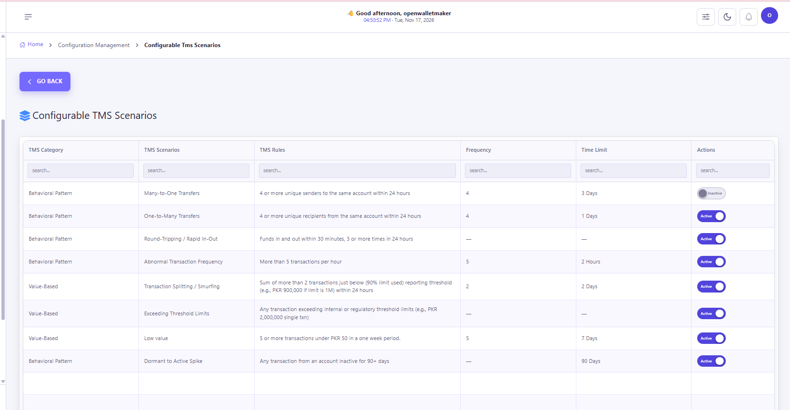

# Configurable TMS Scenarios

The **Configurable TMS Scenarios** screen lets the institution manage the rules used by the Transaction Monitoring System (TMS). Each scenario describes a suspicious pattern. When a customer's transactions match an active scenario, an alert is raised in [Transaction Monitoring](/docs/backoffice/transaction-management/transaction-monitoring).

## Scenario Listing

Each row in the table represents one scenario:

| Column | Description |
| ------ | ----------- |
| **TMS Category** | The group the scenario belongs to: **Behavioral Pattern** (unusual activity patterns) or **Value-Based** (amount thresholds). |
| **TMS Scenarios** | The name of the scenario, e.g. *Many-to-One Transfers* or *Transaction Splitting / Smurfing*. |
| **TMS Rules** | The condition that triggers an alert. |
| **Frequency** | The number of occurrences needed to trigger the alert, where applicable. |
| **Time Limit** | The time window in which the occurrences are counted, e.g. *1 Day* or *2 Hours*. |
| **Actions** | A toggle to make the scenario **Active** or **Inactive**. |

Every column has a search box, so you can quickly filter scenarios.

## Available Scenarios

**Behavioral Pattern**

- **Many-to-One Transfers:** several unique senders transferring to the same account within a short period.
- **One-to-Many Transfers:** one account sending funds to several unique recipients within a short period.
- **Round-Tripping / Rapid In-Out:** funds moving in and out of an account repeatedly within minutes.
- **Abnormal Transaction Frequency:** more transactions per hour than normal.
- **Dormant to Active Spike:** activity on an account that has been inactive for a long time.

**Value-Based**

- **Transaction Splitting / Smurfing:** several transactions just below a reporting threshold.
- **Exceeding Threshold Limits:** a single transaction above an internal or regulatory limit.
- **Low Value:** many very small transactions within a week.

## Activating and Deactivating Scenarios

- Switch the toggle to **Active** to start monitoring a scenario, or to **Inactive** to stop raising alerts for it.
- Deactivating a scenario does not remove alerts that it has already raised.
- Use **Frequency** and **Time Limit** to tune how sensitive each scenario is.

## Notes

- People listed in [Alert Email Recipients](/docs/backoffice/transaction-management/alerts-email-recipients) are notified whenever an alert is raised.
- All changes are recorded in the [Audit Log](/docs/backoffice/audit-management).
