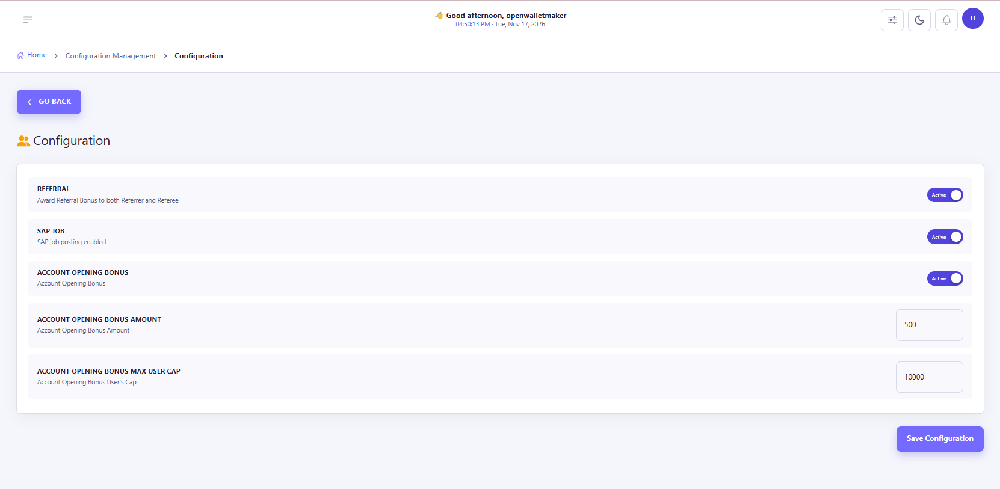

# Configurations

The **Configurations** screen holds system-wide settings that control customer incentives and back-office jobs. Each setting is either switched on or off with a toggle, or set with a value. Changes take effect once you click **Save Configuration**.

## Available Settings

| Setting | Type | What it controls |
| ------- | ---- | ---------------- |
| **Referral** | Toggle | When active, a referral bonus is awarded to **both** the referrer and the referee. |
| **SAP Job** | Toggle | When active, GL postings are sent to the SAP (ERP) system through the scheduled posting job. |
| **Account Opening Bonus** | Toggle | When active, eligible customers receive a bonus when they open an account. |
| **Account Opening Bonus Amount** | Value | The bonus amount credited to each eligible new customer. |
| **Account Opening Bonus Max User Cap** | Value | The total number of customers who can receive the account opening bonus. |

## How the Account Opening Bonus Cap Works

The **Max User Cap** is a running total, not a per-period limit:

1. Each time a customer receives the account opening bonus, the count of bonus recipients goes up by one.
2. When the count reaches the **Max User Cap**, the system **stops** giving the account opening bonus, even though the **Account Opening Bonus** toggle is still active.
3. To resume the bonus, increase the **Max User Cap**. Because the count already includes everyone who has received the bonus, the new cap must be the number already reached **plus** the number of additional customers you want to reward.

**Example:** The cap is set to **10,000** and has been reached. To give the bonus to **2,000** more customers, update the cap to **12,000**. Setting it to 2,000 would have no effect, because the count is already above that number.

## Notes

- Referral bonuses apply only to products whose product group allows referrals (see **Is Referral Allowed?** in [Product Group Setup](/docs/backoffice/product-management/product-group)).
- All changes are recorded in the [Audit Log](/docs/backoffice/audit-management).
- Only users with the right privileges can change configurations.
