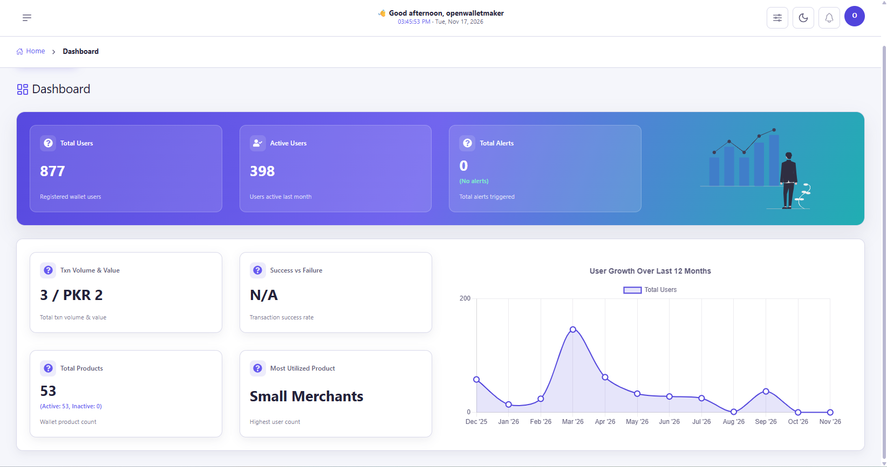

# Dashboard

The **Dashboard** gives a real-time summary of wallet activity across the institution. It is the first screen most back-office users check to understand customer growth, transaction performance and product usage at a glance.

## Key Metrics

The top banner shows headline figures for the customer base and monitoring:

| Card | What it shows |
| ---- | ------------- |
| **Total Users** | The total number of registered wallet users. |
| **Active Users** | The number of users who were active in the last month. |
| **Total Alerts** | The number of alerts raised by [Transaction Monitoring](/docs/backoffice/transaction-management/transaction-monitoring). A value of 0 means no alerts have been triggered. |

## Transaction and Product Summary

| Card | What it shows |
| ---- | ------------- |
| **Txn Volume & Value** | The total number of transactions and their combined value. |
| **Success vs Failure** | The transaction success rate. It shows **N/A** when there are no transactions to measure. |
| **Total Products** | The number of wallet products configured, with a split of active and inactive products. |
| **Most Utilized Product** | The product with the highest number of users. |

## User Growth Chart

The **User Growth Over Last 12 Months** chart plots the number of users added each month over the past year. Use it to spot trends, such as the effect of a campaign or seasonal changes in onboarding.

## Using the Dashboard

- **Monitor growth:** compare Total Users with Active Users to see how engaged the customer base is.
- **Watch for risk:** a rise in Total Alerts is a signal to review open alerts in Transaction Monitoring.
- **Review product performance:** use Total Products and Most Utilized Product to see which offerings customers prefer.

## Notes

- Figures update automatically as new data is recorded.
- The dashboard is read-only. To act on any figure, open the relevant module from the navigation menu.
