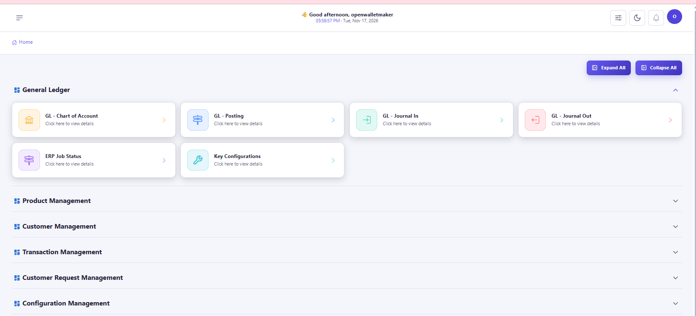
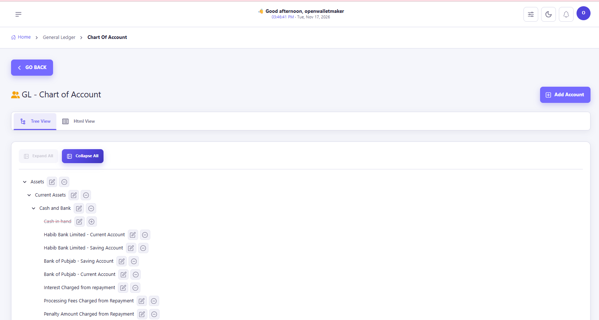
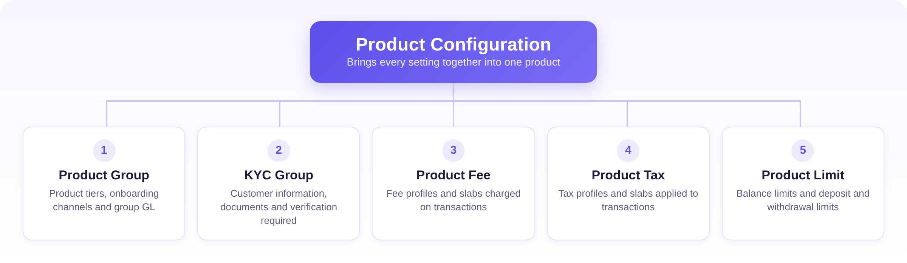

# Backoffice – Set Things Up

This guide walks you through the first two essential configurations every institution must complete before using OpenWallet:  
1. **[Chart of Accounts (COA) Setup)](/docs/backoffice/general-ledger/chart-of-accounts)**  
2. **[Product Setup](/docs/backoffice/product-management/product-configuration)**

---

# Navigating the Backoffice

After you sign in, the **Home** screen groups every Backoffice module into collapsible sections, such as General Ledger, Product Management, Customer Management and Transaction Management. Expand a section and click a card to open that screen, or use **Expand All** / **Collapse All** to show or hide every section at once. The same modules are also listed in the navigation menu on the left.

---

# 1. Chart of Accounts (COA) Setup

The Chart of Accounts is the **foundation of your accounting system**. Every transaction—deposits, withdrawals, transfers, fees, settlements, taxes—eventually posts into the COA.

OpenWallet uses a **4-level hierarchical COA**, providing both structure and flexibility.

---

## 🔵 OpenWallet COA Structure (4 Levels)

> 💡 All financial postings occur at **Level 4**.  
Levels 1–3 are used for classification and reporting.

---

## 📌 What You Configure During COA Setup

- Define the complete **L1 → L4 hierarchy**  
- Assign **unique GL codes**  
- Configure **debit/credit behavior**  
- Map **transaction types** to GL accounts  
- Link GLs with modules (Wallets, Fees, Settlements, Deposits, Loans)  
- Define **reporting and reconciliation** groups  

A properly configured COA ensures **accurate accounting**, **smooth settlements**, and **clean reporting** across all modules.

# 2. Product Setup

Once your COA is fully configured, the next critical step is **Product Setup**.

A *product* defines how a customer account behaves, including fees, limits, taxes, posting rules, and lifecycle behavior.  
Every customer-facing account—wallets, savings comes from product configuration.

---

## 🔵 What a Product Is

A product represents a specific financial offering such as:

- Wallets  
- Savings Accounts  
- Current Accounts  
- Corporate / Merchant Accounts  

Each product determines **how the system handles customer activity** and how those transactions **post into GL accounts**.

---

## 🧩 Key Components of Product Setup

When creating a product, the following items must be configured:
- Product Group
- KYC Group
- Product Fee
- Product Tax  
- Product Limit

