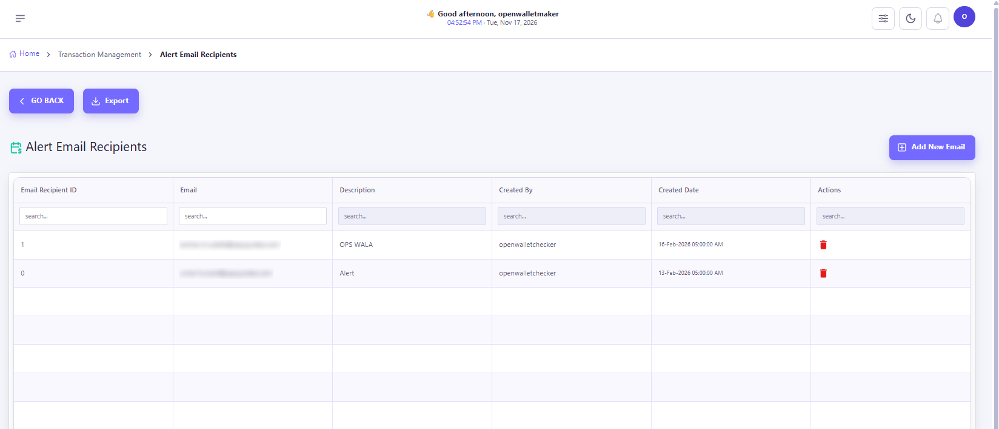

# Alert Email Recipients

The **Alert Email Recipients** module manages the list of people who are emailed whenever [Transaction Monitoring](/docs/backoffice/transaction-management/transaction-monitoring) raises an alert. Typically these are the institution's fraud, risk and compliance contacts, or the relevant authorities, who need to know about suspicious activity as soon as it is detected.

## Recipient Listing

The listing shows every configured recipient:

| Column | Description |
| ------ | ----------- |
| **Email Recipient ID** | A unique identifier for the recipient. |
| **Email** | The address that receives alert notifications. |
| **Description** | A short note on who the recipient is, e.g. *Fraud Team* or *Compliance Officer*. |
| **Created By** | The user who added the recipient. |
| **Created Date** | When the recipient was added. |
| **Actions** | Delete the recipient so they no longer receive notifications. |

Each column has a search box for filtering, and **Export** downloads the list.

## Adding a Recipient

1. Click **Add New Email**.
2. Enter the recipient's **Email** address and a **Description**.
3. Submit the request. The recipient starts receiving notifications once the request is approved.

## How Notifications Work

1. A customer's transactions match an active scenario in [Configurable TMS Scenarios](/docs/backoffice/configuration-management/configurable-tms-scenarios).
2. Transaction Monitoring raises an alert.
3. Every recipient on this list receives an email about the alert, so they can review it promptly.

## Notes

- Keep the list up to date when team members change, so that alerts always reach the right people.
- Adding or removing recipients is recorded in the [Audit Log](/docs/backoffice/audit-management).
