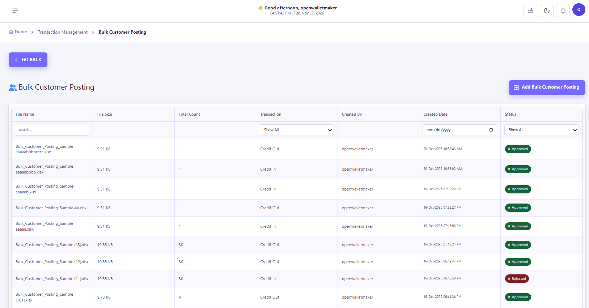

# Bulk Customer Posting

The **Bulk Customer Posting** module works like [Customer Posting](/docs/backoffice/transaction-management/customer-posting), but lets you post to many customer accounts at once by uploading a file instead of posting to each customer one by one.

As with Customer Posting, every posting moves funds between the customer's account and a **GL account**. A debit to the customer's account is credited to the GL account, and a credit to the customer's account is debited from the GL account. This lets operations teams post directly between customer accounts and the general ledger, for example to pay out a bonus from an expense GL or to recover a charge into an income GL.

## How It Works

1. Click **Add Bulk Customer Posting**.
2. Choose the transaction type for the file: **Credit In** (credit customer accounts) or **Credit Out** (debit customer accounts).
3. Upload a file listing the customers and the amount to post to each one.
4. Submit the request for approval.

Each file holds **one transaction type only**. To credit some customers and debit others, upload two separate files.

## Bulk Posting Listing

The listing shows every uploaded file and its progress:

| Column | Description |
| ------ | ----------- |
| **File Name** | The name of the uploaded file. |
| **File Size** | The size of the file. |
| **Total Count** | The number of customer records in the file. |
| **Transaction** | The transaction type applied to the file: **Credit In** or **Credit Out**. |
| **Created By** | The user who uploaded the file. |
| **Created Date** | When the file was uploaded. |
| **Status** | The approval status, e.g. **Approved** or **Rejected**. |

You can filter the list by file name, transaction type, created date and status.

## What This Module Enables

- Post the same kind of entry to many accounts in one step, e.g. bonus payouts, refunds or bulk adjustments
- Reduce manual effort and data-entry errors
- Keep each upload under maker–checker approval

## Notes

- A file is posted only after it is **approved**. Rejected files are not posted.
- All actions are recorded in the [Audit Log](/docs/backoffice/audit-management).
- Only users with the right privileges can upload or approve bulk postings.
