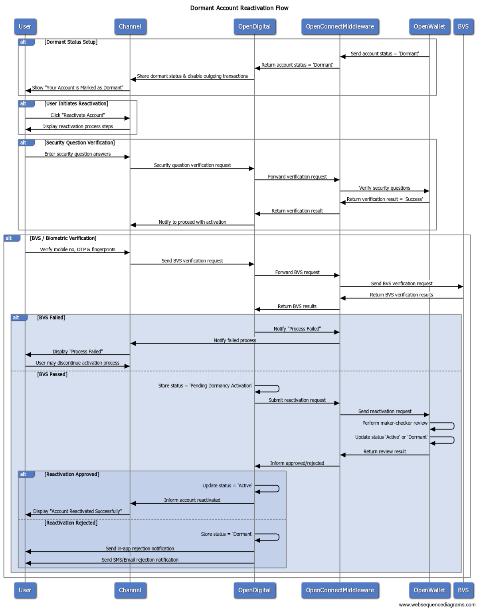

| Participant              | Action |
|--------------------------|--------|
| OpenWallet               | Sends account status = 'Dormant' to OpenConnectMiddleware |
| OpenConnectMiddleware    | Returns account status to OpenDigital |
| OpenDigital              | Shares dormant status & disables outgoing transactions on Channel |
| Channel                  | Shows "Your Account is Marked as Dormant" to the user |
| User                     | Clicks "Reactivate Account" |
| Channel                  | Displays reactivation process steps |
| User                     | Enters answers for security questions |
| Channel                  | Sends security question verification request to OpenDigital |
| OpenDigital              | Forwards security verification request to OpenConnectMiddleware |
| OpenConnectMiddleware    | Sends verification request to OpenWallet |
| OpenWallet               | Returns verification result = 'Success' |
| OpenConnectMiddleware    | Returns verification result to OpenDigital |
| OpenDigital              | Notifies Channel to proceed with activation |
| User                     | Verifies mobile number, OTP & fingerprints |
| Channel                  | Sends BVS request to OpenDigital |
| OpenDigital              | Sends BVS verification request to OpenConnectMiddleware |
| OpenConnectMiddleware    | Forwards BVS request to BVS |
| BVS                      | Returns BVS verification results |
| OpenConnectMiddleware    | Sends BVS results to OpenDigital |
| OpenDigital (Fail Case)  | Notifies "Process Failed" to OpenConnectMiddleware |
| OpenConnectMiddleware    | Notifies Channel about failure |
| Channel                  | Displays "Process Failed" message |
| User                     | May discontinue activation process |
| OpenDigital (Pass Case)  | Stores status = 'Pending Dormancy Activation' |
| OpenDigital              | Submits reactivation request to OpenConnectMiddleware |
| OpenConnectMiddleware    | Sends reactivation request to OpenWallet |
| OpenWallet               | Performs maker-checker review |
| OpenWallet               | Updates status = 'Active' or 'Dormant' |
| OpenWallet               | Returns review result to OpenConnectMiddleware |
| OpenConnectMiddleware    | Informs OpenDigital of approval/rejection |
| OpenDigital (Approved)   | Updates status = 'Active' |
| OpenDigital              | Notifies Channel that account is reactivated |
| Channel                  | Displays "Account Reactivated Successfully" |
| OpenDigital (Rejected)   | Stores status = 'Dormant' |
| OpenDigital              | Sends in-app rejection notification |
| OpenDigital              | Sends SMS/Email rejection alert |

