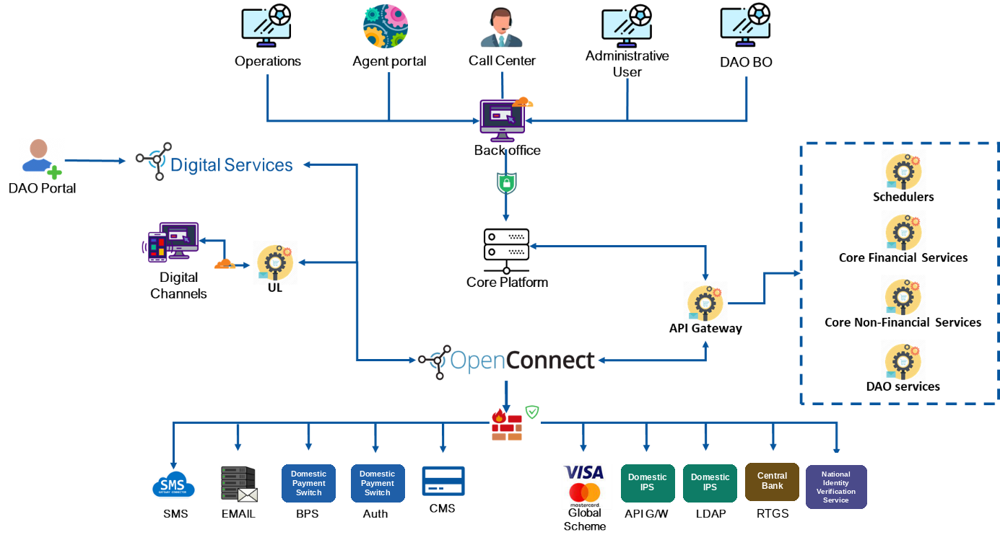
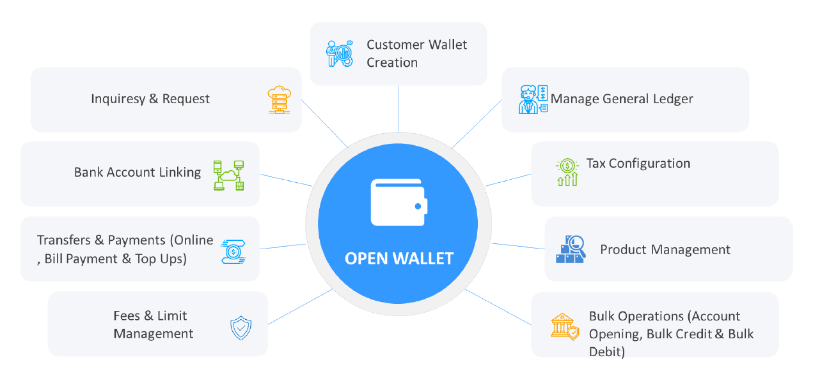

# OpenWallet – Platform & Solution Overview

Welcome to **OpenWallet**, a secure and scalable digital wallet platform designed for banks, fintechs, and enterprises. OpenWallet enables institutions to launch and manage wallet services end-to-end — from onboarding and KYC to payments, limits, fees, and reporting.

This document provides a complete overview of the OpenWallet platform, including solution architecture, core modules, and transaction flows used across channels and integrations.

## Solution Architecture

Wallet offers a comprehensive set of modules to support end-to-end integrations and onboarding processes. This includes a middleware switch for third-party integrations, a digital channel for customer account opening, and an API gateway for seamless connectivity with internal and external systems to manage core financial transactions. 

## Vision & Introduction

> We aspire to be the leading providers of innovative and impactful solutions for digital payments and financial services.

OpenWallet provides an omni-channel wallet management ecosystem supporting:

- Wallet creation & onboarding  
- Digital payments & transfers  
- Merchant payments  
- Transaction history & reporting  
- Compliance & KYC controls  
- Product, fee & tax configuration  
- Core ledger & reconciliation  

The platform is built for performance, security, and interoperability.

## 1. Platform Overview

OpenWallet enables institutions to manage:

- Consumer & business wallets  
- Wallet tiers mapped to KYC levels  
- Limits, controls, fees, and taxes  
- Operational & regulatory reporting  
- API-driven payment flows  

The engine is transaction-agnostic, supporting multiple financial flows including W2W, bank transfers, QR payments, POS, bill payments, and salary disbursements.

## 2. Solution Overview

The OpenWallet platform is an extensive solution designed to manage consumer and dealer wallets or accounts. It enables institutions to define products for consumers and businesses, allowing users and corporate clients to open accounts and maintain balances seamlessly.

The platform incorporates:

- Multi-level Chart of Accounts (COA)  
- Real-time GL posting  
- Scalable application architecture  
- Integrated onboarding & verification  
- API Gateway for internal/external interactions  
- Middleware switch for 3rd-party integrations  

### 2.1 Key Features

### 2.2 Core Modules

#### GL Setup
Configures a multi-level COA and supports:

- Real-time transaction posting  
- Structured financial hierarchy  
- Accurate reconciliation  
- Audit-ready tracking  

#### Master Setup
Prerequisite configurations for product setup:

- Channels  
- Transactions  
- Country  
- City  
- Currency  
- Regions  
- Merchant category codes  
- Taxes  
- Fees  

#### Product Setup
Enables configuration of:

- Product KYC  
- Customer KYC  
- Transaction types  
- GL mappings  
- Transaction limits  
- Fee plans  
- Tax rules  

#### API Gateway
Supports secure internal/external flows:

- Customer onboarding  
- Financial & non-financial transactions  
- Statement retrieval  

#### Recurring Jobs (CBA)

- Daily settlement & reconciliation  
- End-of-day processing  
- Filer/Non-filer updates  
- Tax certificates  
- Compliance screening  
- Profit calculation & disbursement  
- Scheduled deductions  
- Zakat calculation  

#### User Interface

- Digital account opening  
- User management  
- Back office  
- Front office  
- Reports  
- Dashboards  

#### Customer Account Management

##### 1. Account Opening
Handles discrepancies, approvals, KYC, and compliance checks.

##### 2. Account Closure
Supports closures due to customer request, deceased status, or regulatory requirements.

#### Integration with Allied Platforms

Supported via **OpenConnect**:

- AML/CFT  
- National Identity Verification Service (identity and biometric verification)  
- PMD  
- SMS / Email  
- CMS  
- Domestic Instant Payment System (IPS)  
- Domestic Payment Switch – Bill Payment Service  
- Domestic Payment Switch – Authentication Service  
- National Identity Verification Service (e-services)  

Supports REST, SOAP, ISO8583, ISO20022 with consistent CBA protocol.

